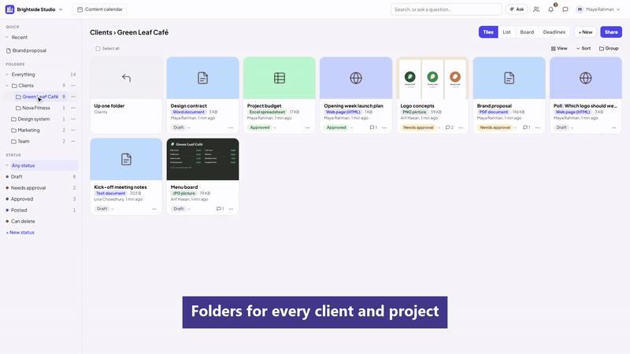
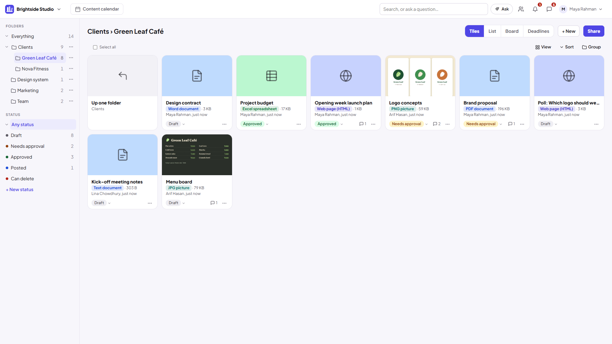
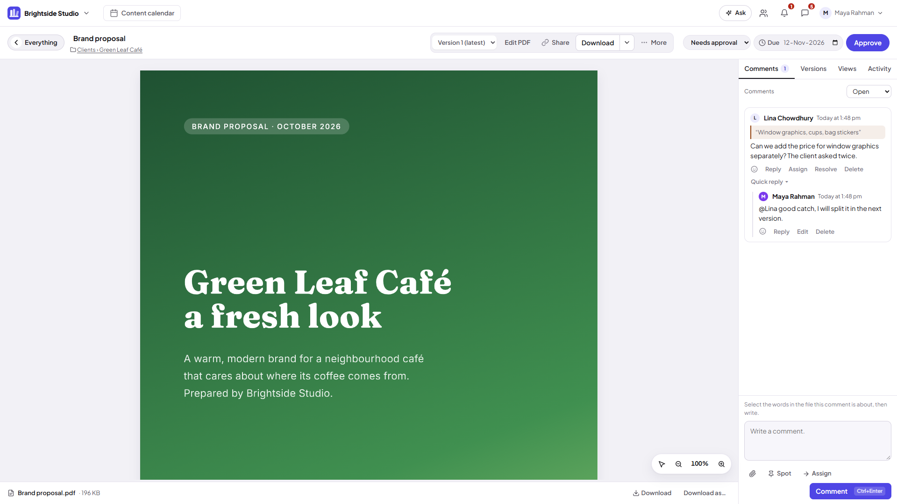
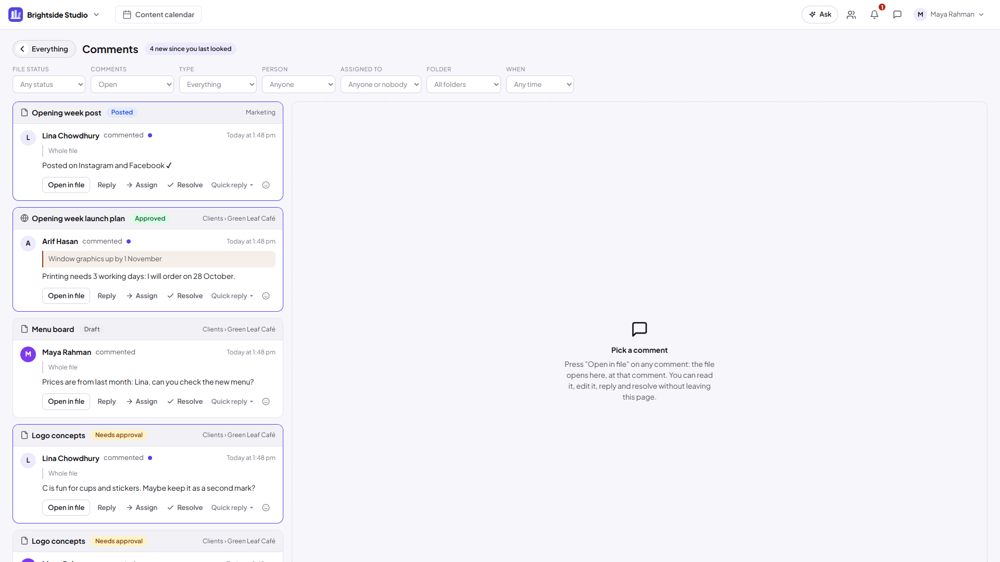

<h1 align="center">TeamShelf</h1>

<b>Your team's work, on one shelf. Not lost in chat.</b> A workspace where files and AI-made pages are shared, commented on, approved and versioned in one place.

<a href="teamshelf-demo.mp4"><b>▶ Watch the full demo video (36 s)</b></a>

---

## Why it exists

At CubeNation, designs, posts and documents were reviewed in chat threads, so feedback got lost and nobody knew which version was the latest. TeamShelf puts every file in one shared shelf, with comments on the exact words, a clear review status and a full version history.

**My role:** I look after TeamShelf as its product owner. I listen to what the team needs, test each new feature with them and help decide what to improve next. The code is written with **AI (Claude)**.

## Features

- **Folders** for every client and project, with **tiles, list, board and deadline** views
- **Search inside files** (PDF, Word, Excel, web pages)
- **Comments on the exact words**, @mentions, replies and tasks
- **Statuses** from draft → needs approval → approved → posted, with one-click approval
- **Every change saved as a version**, with compare and restore
- **Safe share links** so clients can view and comment without an account
- **Ask TeamShelf:** questions answered from the team's own files
- Works in the **browser**, plus **Android** and **Windows** apps
- Connects to AI assistants (Claude, ChatGPT) through an API and MCP connector

## Built with

Cloudflare Workers, D1 database and storage · plain JavaScript · Claude (AI) for code

## Screens

*Screens show a demo team with sample content.*

---

**Sizanul Islam** · [LinkedIn](https://www.linkedin.com/in/sizanulislam/) · sizanul.islam5545@gmail.com
